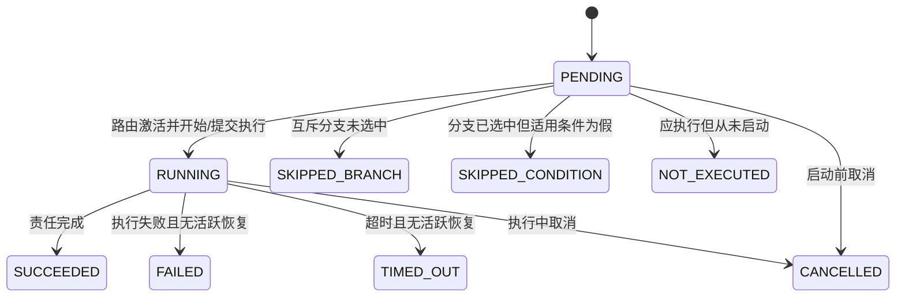
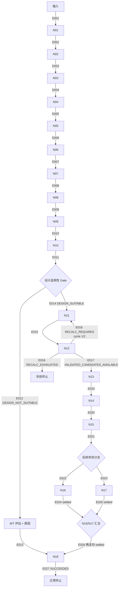
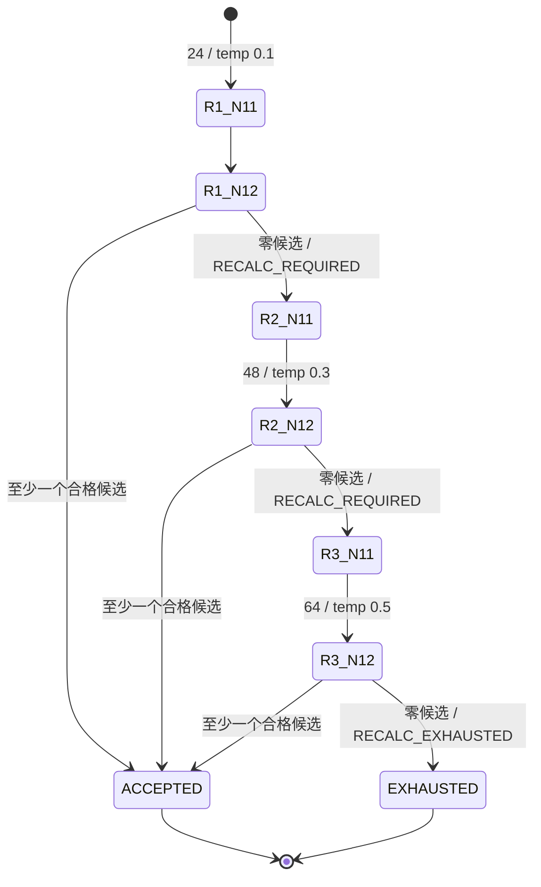

# PH1-MOCK-M1-03 逐边控制流与状态图

> 状态：`COMPLETED`  
> 日期：2026-09-04  
> 状态图版本：`T01-PHASE1-CONTROL-FLOW-v0.1`  
> 适用基线：`T01-PHASE1-18NODE-OFFLINE`  
> 交付边界：只冻结节点间边、控制结果、节点状态、N12 重算和 N16/N17 汇合语义；不定义
> M1-04 完整 Schema，不编写 Mock 代码、Dify DSL 或生产适配器。

## 1. 冻结结论

- 一期业务节点仍严格为 `N01`～`N18`，共 18 个。Gate、WT 说明、分叉、汇合和终止点都是
  控制点，不是 `N19`，也不是旧 `P0-P7` 阶段。
- 本版本冻结 27 条可引用边 `E001`～`E027`，覆盖主链、Gate 两路、N12 回边、N16/N17
  分叉与汇合以及正常/失败终止。
- 节点状态值冻结为 `PENDING`、`RUNNING`、`SUCCEEDED`、`SKIPPED_BRANCH`、
  `SKIPPED_CONDITION`、`FAILED`、`TIMED_OUT`、`CANCELLED` 和 `NOT_EXECUTED`。
  M1-04 负责把这些状态放入正式 envelope，但不得改写其含义。
- Gate 只接受 `DESIGN_SUITABLE` 与 `DESIGN_NOT_SUITABLE` 两个路由结果。真实科学判据仍受
  OI-021 约束；当前 Mock 只能从具名场景取得固定结果，不能自行计算或声称已冻结真实判据。
- N12 跨节点重算最多两次：初始轮加两次重设计，共最多三轮 N11→N12、累计最多 136 个设计。
  工具/运行错误不能冒充“候选全淘汰”并消耗科学重算轮次。
- N16 与 N17 在 N15 后形成两个可观察分支。N16 未提供 `expression_host` 时为条件跳过；
  N17 因膜蛋白或结构低置信而不适用时也保留明确条件跳过事实。两支都进入同一汇合控制。
- N18 只有在 N16、N17 均已落入可汇合终态后才能开始；成功、条件跳过、失败、超时、取消和未执行
  不得被折叠成同一个“已完成”值。
- 默认 profile 仍是完整一期。本文没有启用 reduced profile，也没有为削减项新增状态捷径。

## 2. 依据与适用顺序

1. [M1-01 来源—节点—S 步骤—工具—优先级矩阵](PHASE1_MOCK_M1_01_SOURCE_NODE_STEP_TOOL_PRIORITY_MATRIX.md)
   决定节点成员、步骤归属和控制锚点。
2. [M1-02 节点注册表与责任边界](PHASE1_MOCK_M1_02_NODE_REGISTRY.md)决定唯一节点身份以及各节点可
   消费、可生产的语义事实。
3. [一期 18 节点最新范围原件](<../../../工作流设计/01-业务依据/抗原智能体_v10.5_修订版_20260902/一期裁剪算法图（一期 18 节点 + 落地优先级）.md>)
   决定主链、Gate WT 直达、N15 后双分支和 N18 汇合。
4. [Agent A SOP v10.5](../../../工作流设计/01-业务依据/抗原智能体_v10.5_修订版_20260902/AgentA_SOP_v10.5_20260902.md)
   的 T-01 step16/17、S-28、step21/22 和 step26 决定 N12 轮次、N16/N17 条件与现有 WT
   降级细节；仅采用未被一期图裁剪的内容。
5. [当前一期范围基线](../PHASE1_SCOPE_REBASELINE.md)、[当前架构](../ARCHITECTURE.md)和
   [开放项](../OPEN_ITEMS.md)用于约束后端判定、Dify 路由、未决项和实现边界。

最新用户决定与一期图优先于专家包中的旧入口行为。旧 Mock、旧 P0-P7 计划和旧场景不作为边或
状态来源。

## 3. 节点状态词典

### 3.1 规范状态

| 状态 | 是否终态 | 精确定义 |
|---|---:|---|
| `PENDING` | 否 | 节点属于本次运行的可观察拓扑，但尚未被激活或被控制器最终归类 |
| `RUNNING` | 否 | 节点至少有一个已激活执行；异步提交、轮询或受控恢复尚未结算时均保持非终态 |
| `SUCCEEDED` | 是 | 节点已完成其注册责任并形成可验证结果；对 Mock 仅表示工程执行成功，不表示科学有效或生产部署 |
| `SKIPPED_BRANCH` | 是 | 上游选择了互斥的另一条业务分支，因此该节点不应执行；Gate WT 直达时 N11-N17 使用此状态 |
| `SKIPPED_CONDITION` | 是 | 已进入包含该节点的分支，但节点自身适用条件为假；必须携带可追溯原因 |
| `FAILED` | 是 | 执行已启动或被后端接受，最终以错误结束且当前没有活跃恢复尝试 |
| `TIMED_OUT` | 是 | 执行超过后端规定期限且当前没有活跃恢复尝试；不能被改写为普通失败或空成功 |
| `CANCELLED` | 是 | 执行或待执行工作被明确取消；必须区分分支级取消和整次运行取消 |
| `NOT_EXECUTED` | 是 | 路由本应到达或节点输入责任已成立，但因上游阻断、无法启动或完整性问题从未开始执行 |

`settled` 只是本文用于描述“已经进入任一终态”的派生谓词，不是第十个状态值。节点已有
`FAILED`、`TIMED_OUT` 或 `CANCELLED` 记录后，如获准恢复，必须创建新尝试并保留
旧尝试；不得把旧终态原地改回 `RUNNING`。尝试结构、时间戳、错误对象和恢复关联由 M1-04
定义。

### 3.2 通用状态迁移

以下区分是强制的：

- “走了另一条路”是 `SKIPPED_BRANCH`；“进入本路但条件不满足”是
  `SKIPPED_CONDITION`。
- “已经运行后报错”是 `FAILED`；“本应运行但没有启动”是 `NOT_EXECUTED`。
- 空数组、`null`、缺字段、WARNING 或没有候选都不是节点状态，不能代替上述枚举。
- 整次运行取消时，尚未执行节点按 `NOT_EXECUTED` 结算，N18 不因分支汇合规则而强行启动。

## 4. 总体状态图

图中的 `GATE`、`WT`、`FORK`、`JOIN`、`END` 和 `FAIL` 只是控制标签，
不进入 M1-02 节点注册表，也不是 M1-06 的运行时资产名称。

## 5. 逐边冻结表

`edge_id` 是本规格和后续机器断言的稳定引用，不是业务节点 ID，也不提前定义 workflow、tool、
scenario、run_id、template 或 bound 命名。

| edge_id | 起点 | 唯一触发条件/结果 | 终点 | 状态与审计要求 |
|---|---|---|---|---|
| `E001` | 输入控制 | 请求通过 M1-04 将定义的入口校验并被接受 | `N01` | N01 从 `PENDING` 进入 `RUNNING` |
| `E002` | `N01` | `SUCCEEDED` | `N02` | 不得插入 S-07 或外部结构检索 |
| `E003` | `N02` | `SUCCEEDED` | `N03` | 顺序边 |
| `E004` | `N03` | `SUCCEEDED` | `N04` | 顺序边 |
| `E005` | `N04` | `SUCCEEDED` | `N05` | 顺序边 |
| `E006` | `N05` | `SUCCEEDED` | `N06` | 顺序边 |
| `E007` | `N06` | `SUCCEEDED` | `N07` | 当前完整 profile 不得静默越过 N07 |
| `E008` | `N07` | `SUCCEEDED` | `N08` | 顺序边 |
| `E009` | `N08` | `SUCCEEDED` | `N09` | 顺序边 |
| `E010` | `N09` | `SUCCEEDED` | `N10` | 顺序边 |
| `E011` | `N10` | `SUCCEEDED` | Gate | N10 只提供事实，Gate 结果由后端控制判断产生 |
| `E012` | Gate | `DESIGN_NOT_SUITABLE` | WT 控制 | 合法 Gate 结果之一；原因必须保留 |
| `E013` | WT 控制 | WT 基线与原因已准备 | `N18` | N11-N17 全部置 `SKIPPED_BRANCH`；这是可正常交付的 WT 路径 |
| `E014` | Gate | `DESIGN_SUITABLE` | `N11` | 合法 Gate 结果之一 |
| `E015` | `N11` | 当前设计轮成功产生待验证候选 | `N12` | N11 与 N12 使用同一设计轮编号 |
| `E016` | `N12` | `RECALC_REQUIRED` 且当前轮为 1 或 2 | `N11` | 轮次加一；保留此前设计与验证尝试，不覆盖 |
| `E017` | `N12` | `VALIDATED_CANDIDATES_AVAILABLE` | `N13` | 至少一项候选通过 N12 当前完整处理后才可走此边 |
| `E018` | `N12` | 第 3 轮仍无合格候选，`RECALC_EXHAUSTED` | 失败终止 | N12 最终为 `FAILED`；N13-N18 为 `NOT_EXECUTED`；形成 FailureReport 语义 |
| `E019` | `N13` | `SUCCEEDED` | `N14` | 顺序边 |
| `E020` | `N14` | `SUCCEEDED` | `N15` | 顺序边 |
| `E021` | `N15` | `SUCCEEDED` | 分叉控制 | N15 的候选/WT 建议作为后端事实继续传递，不由分叉控制重算 |
| `E022` | 分叉控制 | N16 分支被激活并评估其输入与适用条件 | `N16` | N16 必须形成执行、条件跳过或未执行等明确状态 |
| `E023` | 分叉控制 | N17 分支被激活并评估其输入与适用条件 | `N17` | N17 是受保护节点，不能因与 N16 并列而被静默删除 |
| `E024` | `N16` | N16 被控制器最终结算为可汇合终态 | 汇合控制 | 传递原状态、原因和可用产物，不改写为成功 |
| `E025` | `N17` | N17 被控制器最终结算为可汇合终态 | 汇合控制 | 传递原状态、原因和可用产物，不改写为成功 |
| `E026` | 汇合控制 | N16、N17 两支均已结算 | `N18` | 任一支仍为 `PENDING`/`RUNNING` 时禁止提前进入 N18 |
| `E027` | `N18` | `SUCCEEDED` | 正常终止 | 交接可为 delivered/pending/declined 事实；无证据不得声称 Agent C 已接通 |

阻断规则不为每个节点复制一条图边，但同样冻结：

1. N01-N15 任一节点最终为 `FAILED`、`TIMED_OUT` 或运行级 `CANCELLED`，且没有活跃恢复时，
   不得走其成功边；下游未启动节点为 `NOT_EXECUTED`，运行进入失败或取消终止。
2. Gate 缺失、返回未知值或评估失败时不得默认走“适合”或“不适合”，必须进入控制失败。
3. N16/N17 的分支级 `FAILED`、`TIMED_OUT`、`CANCELLED` 或 `NOT_EXECUTED` 可以结算到
   汇合控制，由 N18 披露缺口；整次运行取消不适用此宽容规则。
4. N18 自身失败时进入失败终止，不能用已有部分产物伪造正常完成。

## 6. Gate 与 WT 直达分支

| Gate 结果 | 路由 | 节点状态后果 | 交付语义 |
|---|---|---|---|
| `DESIGN_SUITABLE` | `E014` 进入 N11 | N11-N17 按设计路径实际执行或结算 | N18 可根据已产生的后端事实组装候选或 WT 降级结果 |
| `DESIGN_NOT_SUITABLE` | `E012`→`E013` 直达 N18 | N11-N17 均为 `SKIPPED_BRANCH` | N18 组装 WT 评估、跳过原因、证据和风险；整条运行可正常完成 |

Gate 的冻结范围只有“结果值 + 路由 + 状态后果”：

- 最新一期图中的“明显不适合设计”和 SOP 中的膜蛋白/低置信示例都不能在 OI-021 关闭前被
  实现方擅自扩写成完整判定式。
- Gate 结果的权威生产者是 MCP/后端；Dify 只比较固定结果并走边，LLM 不得判断。
- Mock 场景必须直接声明预期 Gate 结果和原因，并标记为场景事实；不得根据模拟分数反推结果。
- Gate WT 直达是唯一冻结的“绕过 N11-N17”业务边。它不是失败，也不能把跳过节点记成
  `SUCCEEDED`。

## 7. N12 受控重算

### 7.1 轮次与停止条件

| 设计轮 | N11 设计数 | 采样温度 | N12 结果为零时 | 累计设计上限 |
|---:|---:|---:|---|---:|
| 1 | 24 | 0.1（当前 SOP 默认） | `RECALC_REQUIRED`，走 `E016` | 24 |
| 2 | 48 | 0.3 | `RECALC_REQUIRED`，走 `E016` | 72 |
| 3 | 64 | 0.5 | `RECALC_EXHAUSTED`，走 `E018` | 136 |

任一轮只要产生至少一个完成 N12 处理的合格候选，即返回
`VALIDATED_CANDIDATES_AVAILABLE` 并走 `E017`；后续轮不再运行。基线分数应按 SOP 在各轮
复用，所有轮次输入、参数、候选和验证结果都必须保留，具体承载结构由 M1-04 定义。

### 7.2 重算护栏

- S-28 内部已有的 ESM-IF1 恶化容忍 10%→15%→20% 松弛属于同一 N12 轮内部行为，
  只进入 relaxation history；它不增加设计轮，也不生成额外 N11 回边。
- 只有后端明确返回“本轮完整验证后无合格候选”才可产生 `RECALC_REQUIRED`。Schema 错误、
  工具崩溃、超时、取消、产物损坏或未知响应均走错误/恢复路径，不得当作科学全淘汰。
- 轮次和参数由后端状态控制；Dify 只消费固定结果和轮次，不能自行加一、修改 24/48/64、
  调温或决定何时停止。
- N11/N12 在循环退出前的节点聚合状态保持非终态；M1-04 必须允许保存逐尝试结果。通过时两节点
  最终为 `SUCCEEDED`；耗尽时最后一次 N11 可成功，而 N12 最终为 `FAILED`。
- 禁止第四轮、无限回边、覆盖旧轮结果或只保留最后一个候选集合。

## 8. N16/N17 条件与 N18 汇合

### 8.1 N16 条件执行

| 上游/输入事实 | N16 结算 |
|---|---|
| 设计分支已到达、N15 提供可优化候选、`expression_host` 明确且通过后续契约校验 | N16 进入 `RUNNING`，再结算为实际终态 |
| 设计分支已到达、候选可用，但未提供 `expression_host` | `SKIPPED_CONDITION`，原因固定表达为未提供表达宿主 |
| Gate 选择 WT 直达 | `SKIPPED_BRANCH` |
| 设计分支已到达但没有可供 N16 消费的候选 | `NOT_EXECUTED`，保留上游缺失原因 |

`host_species` 不能代替或推导 `expression_host`。如果用户提供了无效或不支持的表达宿主，
不得静默当成“未提供”；由 M1-04 冻结它是在入口拒绝还是 N16 `FAILED`，但两种情况下都不能
产生伪 DNA 结果。

### 8.2 N17 适用性

N17 的业务身份和 `E023` 分支始终保留。按当前 SOP step22：

- 设计路径到达、`protein.is_membrane=false` 且结构质量不是 low 时执行 WT/PositionScan。
- 设计路径到达但蛋白为膜蛋白，或结构质量为 low 时，结算为
  `SKIPPED_CONDITION` 并保留原因。
- Gate WT 直达时为 `SKIPPED_BRANCH`，不因 N17 是 WT 参考扫描而逆向恢复已绕过的设计分支。
- 应执行但前置结构/映射不可用且未启动时为 `NOT_EXECUTED`；已启动后工具报错为
  `FAILED`。两者不能互换。

这项条件语义不会把受保护的 N17 从完整 profile 删除；它只描述单次运行的适用性结果。

### 8.3 汇合规则

设计路径上的 N16/N17 汇合采用“全部结算”而不是“全部成功”：

| N16 | N17 | 汇合动作 |
|---|---|---|
| `SUCCEEDED` | `SUCCEEDED` | 立即允许 `E026` |
| `SKIPPED_CONDITION` | `SUCCEEDED` | 允许 `E026`；N18 披露 N16 条件跳过 |
| `FAILED` | `SUCCEEDED` | 允许 `E026`；N18 保留错误和已有结果 |
| `NOT_EXECUTED` | `FAILED` | 允许 `E026`；N18 分别披露“未执行”和“失败” |
| 任一为 `PENDING` 或 `RUNNING` | 任意 | 禁止进入 N18，继续等待或由后端执行超时/取消/恢复 |
| 整次运行已取消 | 任意 | 不进入 N18；运行按取消规则终止 |

可汇合终态集合为 `SUCCEEDED`、`SKIPPED_CONDITION`、`FAILED`、`TIMED_OUT`、
`CANCELLED` 和 `NOT_EXECUTED`。`SKIPPED_BRANCH` 只用于未选中的业务分支；Gate WT
直达不经过此汇合控制。

N18 必须逐支保留原状态、原因、尝试与可用产物，不能执行以下折叠：

- 把 `SKIPPED_CONDITION`、`FAILED` 或 `NOT_EXECUTED` 改成 `SUCCEEDED`；
- 用空对象、空数组或默认科学值掩盖失败/缺失；
- 因一支失败而丢弃另一支已经成功的结果；
- 在另一支仍运行时提前组装最终结果。

## 9. N15 WT 降级与 Gate WT 的区别

最新一期图在 N15 内保留 SC-10，当前 SOP 还描述“全部候选被硬过滤”或最优候选低于 SC-10 时的
WT 降级。该语义与 Gate WT 直达不同：

- Gate WT 在 N10 后发生，N11-N17 全部为 `SKIPPED_BRANCH`。
- N15 的 WT 降级建议是在 N11-N15 已实际执行后形成的后端事实，不能反向把这些节点改成跳过。
- 本状态图保持 `E021`～`E026`：N17 仍可形成 WT 参考事实；N16 根据是否存在可消费候选及
  `expression_host` 如实执行、跳过或未执行；N18 再组装 WT 降级结果和完整原因链。
- 在 OI-010 关闭前，Mock 只能由具名场景提供“WT 降级建议”，不能自行计算 `<0.30`，也不能
  新增“用户选择 failure_report”路由。WT 与失败的最终生产分叉若被裁决为新边，必须升级本状态图。

因此，`T01-PHASE1-CONTROL-FLOW-v0.1` 唯一冻结的提前绕过边仍是 Gate WT 直达；N15 的
WT 建议是结果选择事实，不是第二条未经裁决的旁路。

## 10. 负向不变量

后续 Schema、场景、Mock、Dify 和测试必须共同拒绝以下行为：

1. 把 Gate、WT、FORK、JOIN、END 或 FAIL 注册为第 19 个业务节点。
2. 从 N01 恢复 S-07、RCSB PDB、AlphaFold DB、联网 BLAST/UniProt/AFDB fallback。
3. 由 LLM/Dify 计算 Gate、N12 是否重算、Hard Filter、Pareto 或 SC-10。
4. Gate 结果缺失/未知时默认进入任一业务分支。
5. 把 N12 工具错误当作全淘汰，或执行超过三轮 N11→N12。
6. 用 `host_species` 推断 `expression_host`，或把 N16 条件跳过记为成功。
7. 在 N16/N17 任一支未结算时进入 N18，或在 N18 中补算缺失科学结果。
8. 把 `SKIPPED_BRANCH`、`SKIPPED_CONDITION`、`FAILED` 和 `NOT_EXECUTED` 合并。
9. 在 OI-020 未关闭时添加 reduced profile 跳边。
10. 使用 P0-P7 阶段名、旧 workflow 或旧 Mock 场景作为本状态图的路由事实。

## 11. 未决项与版本边界

| 未决项 | 本版本已冻结 | 本版本明确未冻结 |
|---|---|---|
| OI-021 Gate | 两种结果值、两条边、WT 路径状态后果 | “明显不适合”的完整科学判定式、阈值和生产证据 |
| OI-010 SC-10 | N15 结果事实可由 N18 消费；具名 Mock 场景可表达 WT 建议 | `<0.30` 的生产执行与“WT/失败”用户选择接口及额外失败边 |
| OI-004 表达宿主 | N16 只认明确 `expression_host`；缺失为条件跳过 | 正式字段类型、别名、支持值、无效值的入口/节点错误分界 |
| OI-013/014 N18 | N18 的启动条件、汇合责任和不得伪造 delivered | Agent C 接口、认证、幂等、确认以及完整 Candidate/Failure Schema |
| OI-015 N12 | 三轮设计规模、温度、回边与停止 | R-58 余下细节和完整错误对象 |
| OI-020 削减 | 默认完整 profile，无削减边 | reduced profile 的状态、补回和披露 |
| OI-022 排序 | N13→N14→N15 顺序与 N15→双分支 | 缺值、并列、top20 等尚待裁决的完整排序契约 |

未决项不会使当前 Mock 拥有自由判断权。具名场景可提供固定控制事实；生产规则仍保持未冻结和
`NOT_DEPLOYED`。

## 12. 验收记录

| 检查 | 结果 | 证据 |
|---|---|---|
| 节点集合 | `PASS` | 图中业务节点严格为 N01-N18；控制点未注册为节点 |
| 逐边覆盖 | `PASS` | `E001`～`E027` 唯一，无重复 edge_id |
| Gate/WT | `PASS` | 两个固定结果；WT 直达令 N11-N17 为 `SKIPPED_BRANCH` |
| N12 重算 | `PASS` | 24/0.1 → 48/0.3 → 64/0.5，最多三轮、136 个设计 |
| N16 条件 | `PASS` | 只消费明确表达宿主；缺失与无效、跳过与失败不混同 |
| N17 保护 | `PASS` | 分支身份保留；不适用时形成条件跳过而非删除 |
| N16/N17 汇合 | `PASS` | 两支全部结算后进入 N18；失败、未执行与条件跳过均可区分 |
| 未决规则 | `PASS` | OI-004/010/013/014/015/020/021/022 均未被猜测关闭 |
| 旧范围回流 | `PASS` | 无 P0-P7 路由，无一期排除能力回流 |
| Schema/实现越界 | `PASS` | 未定义完整字段结构，未新增 Mock 代码、Dify DSL 或生产实现 |

## 13. 后续交接

- `PH1-MOCK-M1-04` 必须把本文状态、Gate 结果、edge/attempt 追溯、分支原因和 N18 汇合证据
  放入正式 envelope；可以决定字段结构，不能改变本文路由含义。
- `PH1-MOCK-M1-05` 为主链、Gate WT、N12 第二/第三轮、N16 条件跳过、N16/N17 分支失败与
  恢复建立确定性场景；所有控制结果由场景显式给出。
- `PH1-MOCK-M1-07` 直接以 `E001`～`E027`、状态词典、三轮上限和汇合不变量生成
  机器断言。

