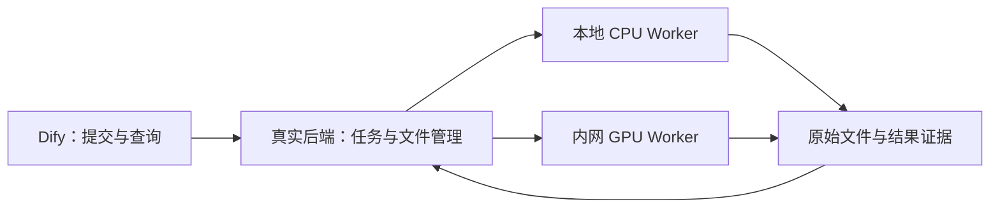
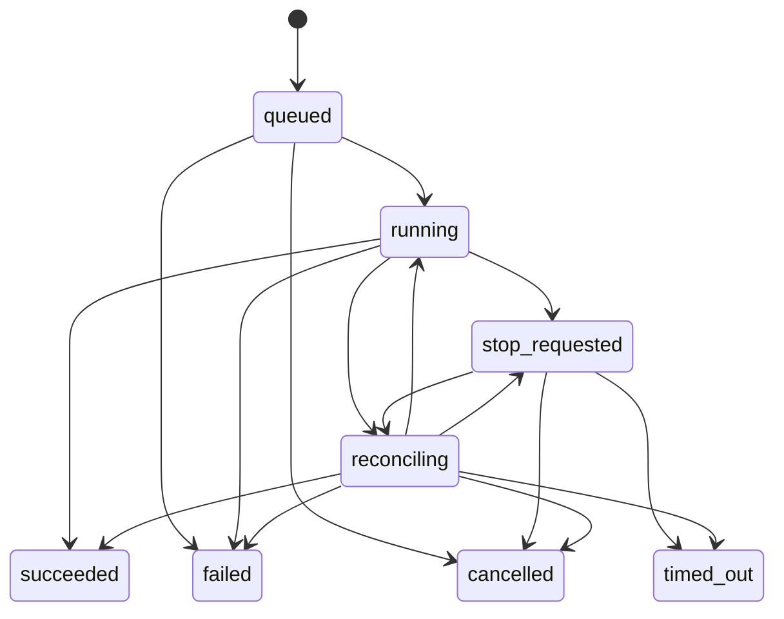

# W1-07：真实契约、任务状态与隔离设计

> 前序设计/评审参考：下文保留原时点的准备范围和结论；当前开发顺序由 [W1 交付任务](PHASE1_REAL_W1_BACKLOG.md)与 [现行计划](../PHASE1_DELIVERY_PLAN.md)覆盖。原科学未签收事实和机器证据保持原义，接手不必通读本页。

本任务把已有工具事实接成可实施的后端约定。当前进度和下一任务见 [STATUS](../STATUS.md)，
分模块推进依据见 [用户采用记录](../sources/PHASE1_W1_MODULAR_DEVELOPMENT_20260905.json)。
业务范围仍是完整 N01–N18；本次只处理 W1 的 N01–N02。

## 1. 本次交付与阅读顺序

先读本页，再读 [工程 Schema 与登记](../../../工作流设计/02-数据契约/phase1-real-v0.1/README.md)，
最后按 [通用运行层实施任务](PHASE1_REAL_W1_RUNTIME_BACKLOG.md)开发。

现有 [工具接口 v0.1](../../../工作流设计/02-数据契约/tool-interface-v0.1/README.md)继续描述一次工具调用。
本次新增上层任务、不可变输入快照、受控文件引用和模块依赖；不改两份历史工具包，不将新工具塞进旧 Schema 的任意对象。
工程检查与放行范围见 [评审记录](PHASE1_REAL_W1_CONTRACT_REVIEW.json)。科学 payload 下表是来源归并草案，
必须经对应工具评审后才能用于正常科学消费。

## 2. 分模块开发与放行

| 模块 | 工作内容 | 开发前条件 | 不由本模块宣布完成的内容 |
|---|---|---|---|
| A 通用工程 | 请求/任务/尝试身份、持久化、轮询、幂等、停止/恢复、文件校验、Worker 注册 | W1-08A 工程契约评审；仅用独立工程测试 Worker | 科学工具运行、科学规则通过、真实 N01/N02 完成 |
| B1 本地结构与映射 | 原始解析、实体/作者编号、候选映射和复核记录 | 各自 G0 事实、输入支持范围、OI-015/023 的适用规则与评审 | 候选映射自动升级为 verified；替其他消费者验收 |
| B2 DeepTMHMM | 原包执行封装、原始标签和区段解析、四标签/null 守卫 | Academic 开发证据、输入支持域与独立参考、对应工具 G1 | P/B 转成普通标签；目标 GPU/长输入自动视为可用 |
| B3 S-09 | 来源分流、置信度/掩码、复核与条件判定 | 已有规则与先行决定、OI-023/024 的适用确认、边界预期 | 将用户先行采用冒充算法签收 |
| B4 FreeSASA | 结构上下文、原始面积、映射、RSA 与错误 | 原工具证据、已批准映射/上下文/参数及参考；OI-027 正常消费口径闭合 | 把 G76 出域或 unverified 映射当正常 RSA |
| C 预测模型 | AF3 与 ESMFold2 各自适配、输出解析、资源和禁网验证 | 对应服务器/资产、实际 G0 输出、样本与参数/标度 G1 | 用源码、人工输出或上传结构替代预测能力验收 |

W1-08A、W1-08B（按工具）、W1-08C（按引擎）是原 W1-08 的分项评审；
W1-09A/B/C 是对应实施子项，不是新增波次。A 不依赖 AF3/ESMFold2 权重；B 只依赖自己的科学前置项及所用 A 接口。
C 的 AF3 与 ESMFold2 分别核验，涉及两引擎的降级链仍须共同联调。

A 评审只允许通用工程开发和工程 Worker 验证；B/C 未经自身 G0/G1 不进入正式科学适配器实现。
开发机 profile 的验证不能替代目标环境部署。W1-08 总评、W1-09 集成、W1-10～13 的完整离线包、
Dify、波次验收及冻结仍要求全部适用模块与依赖齐备。部分放行不把 W1 写成完成，也不自动放行后续波次的生产依赖。

## 3. 服务与部署边界

先实现单机持久化与受控子进程 Worker；远程 GPU 接入是后续 C 模块的部署适配，不在 A 阶段声称已接通。
上层通过统一提交/查询/取消操作访问任务；MCP/HTTP 只是传输层，Dify run ID 仅作关联。
LLM 与 Dify 不计算科学值、不推断复核结论、不自行选择引擎。

候选命名登记在 `contract.json`：Python `t01_phase1_real`、provider `t01-phase1-real-mcp-v01`、
服务接口版本 `0.1.0`，与现有工具协议同为 0.1.0 但分别记录。真实 Workflow/生成器路径预留，尚未创建。
保留已存在的 `t01.real.freesasa` 工具身份；新增工具分别登记，不复用 Mock 26-tool 集合。

部署目录配置为受控绝对根，持久化相对布局为 `runs/{run_id}/jobs/{job_id}/attempts/{attempt_id}/`。
开发测试根与真实运行根必须不同；禁止落在冻结 Mock、legacy、专家原件、工具包或 discovery 历史批次内。
同一调度配置不得同时加载 Mock provider 与真实 provider。工程 Worker 仅处理无生物学意义的字节输入，
标注 ENGINEERING_FIXTURE，不能提供正常科学结果。

## 4. 请求、身份与幂等

N01 业务输入沿用 `protein_sequence`、`host_species` 和可选本地结构；表达宿主保持独立。
上游保留用户原输入，规范化序列单独留 hash；A 层只处理字节与引用，不裁定 OI-023 的生物学支持域。
生产请求目录、宿主支持集和来源元数据的完整校验仍由 B/C 的适用输入契约补齐。

| 身份 | 责任与用途 |
|---|---|
| run_id | 后端生成，一次业务运行；重算的运行谱系单独记录，不能用 Dify ID 代替 |
| request_id | 调用方给定的逻辑工具请求；与旧公共接口一致，显式重试保留逻辑身份 |
| job_id | 后端接受一次调度后生成；重试产生新 job，关联 retry_of_job_id |
| attempt_id | Worker 为实际执行生成；同一进程恢复跟踪保留，重新执行必须新建 |
| revision / lease_epoch | revision 防止状态并发覆盖；lease_epoch 与不可复用执行标识阻止旧 Worker 提交结果 |
| artifact_id | 后端登记的不可变文件身份；与 job/attempt、原始大小、SHA-256 和证据种类绑定 |

`job.schema.json` 是状态快照格式；`submit.schema.json` 是调度请求格式。业务和科学请求保存为已验证的
request artifact，完整原始字节不可修改。提交者不传任意宿主路径、镜像、shell 命令或网络地址；
使用已登记且有 hash 的执行 profile 和 ArtifactRef。

幂等键取 `(已认证调用范围, 操作, idempotency_key)`；JSON body 原始字节 SHA-256 是比较依据，
同 key 同 body 返回原 job，同 key 不同 body 返回 IDEMPOTENCY_CONFLICT，不创建第二次执行。
同一请求仅改变 JSON 空白也视为冲突，调用方须保留原字节。鉴权范围由服务端提供，不信任客户端声明。
首次受理、幂等索引、job 和 queued 事件须在同一个数据库事务中提交，崩溃不能留下半份登记。

接口操作是传输无关的 `create_run/submit/get/cancel/retry`；create_run 原子分配服务端 run_id，
提交和控制操作均验证调用方对 run/job 的权限。`control.schema.json` 明确创建/查询/取消/重试请求，
所有写操作都采用上述幂等规则；控制键与提交键按 operation 区分。
提交被拒绝时返回结构化错误，不伪造失败作业。
接受提交返回 job 快照；查询读取已提交状态；取消记录意图；retry 只克隆原不可变输入和 profile，
需要新的幂等键、生成新 job 并保留父 job。改变输入/参数属于新请求，不是原任务重试。
create_run 返回 `{contract_version, run_id, created_at}`；submit/get/cancel/retry 返回 job Schema 的快照。
拒绝返回 `{contract_version, error:{code, message, job_id}}`，尚无或不可访问的 job_id 为 null；
code 来自 contract.json 错误表，message 不回显凭据、任意宿主路径或原始序列。错误响应不能被包装为成功 job。

## 5. 状态、超时与恢复

全部终态不可修改。精确允许边在 `contract.json`；图表示生命周期，不授予科学消费权限。
queued→failed 用于执行前资产失效等问题；尚未启动的取消必须有“未启动”事实。
running→succeeded 要求进程成功退出、结果 schema/文件/身份检查通过并原子提交。
工具结果 `execution_status=failed` 映射 job.failed；成功完成的 skipped 条件记录可映射 job.succeeded，
但保留 skipped 语义，不声称运行了科学工具。

停止规则：

1. queued 取消与 Worker 认领竞争时使用同一事务；谁先提交就按对应状态处理。
2. running 收到取消或超时先变 stop_requested，持久化 stop_reason，再停止**该次执行**的进程树/容器。
3. 只有确认进程已经结束才记录 cancelled/timed_out。停止请求超时或主机失联进入 reconciling，不能假报停止成功。
4. stop_reason 已提交后到达的成功结果仅可保留诊断，不覆盖取消/超时；已提交成功后到达的取消返回原终态。
5. 排队等待、基础设施租约失联、Worker wall-time 和科学规则的超时分别记录。A 不自行触发 AF3→ESMFold2，
   更不能把几秒工程超时当作 S-08 的 >2h 条件。

恢复规则：启动时扫描非终态；queued 可重新认领，running/stop_requested 必须先对账。
同一次执行仍在运行则恢复监控，不能重跑；有完整已验证结果且无停止意图可完成提交；
确认执行消失且无结果才记 INTERRUPTED。状态不明保持 reconciling，不释放到第二个 Worker。
认领时先登记唯一执行身份，启动与登记之间的崩溃须能按该身份找到进程；不能仅凭可复用 PID 认领或杀进程。
job.started_at 记录本次执行分派开始时间，实际工具进程的开始/结束时间与退出事实由 Worker 单独留证，
因此分派后、进程启动前崩溃不会被误记为模型已经执行。
已过期 lease 的回传必须拒绝；接管时登记新 epoch，并通过对账读取同一执行，不能接收旧回调直接写结果。

MVP 不自动重试科学任务、不跨服务器自动迁移。显式 retry 只接受已终止的 failed/timed_out/cancelled job，
再次验证资产和模块资格；succeeded 或 reconciling 不能 retry。恢复、重试与 W5 业务重算是三种不同操作。

## 6. 文件与科学消费边界

服务 ArtifactRef 只有受控身份、run/job/attempt、角色、大小、SHA-256 和证据种类，不暴露物理路径。
服务端解析存储引用后检查路径处于配置根内，拒绝 `..`、绝对路径、符号链接/重解析点逃逸，
并在实际打开/拷贝和执行前复核；校验后文件改变不能继续运行。清理只针对已确认终止作业的明确目录。

输入先作为不可变快照登记；Worker 写独立临时目录，关闭文件后计算 hash，由后端原子发布结果清单。
中途崩溃的文件只能是未提交诊断，不能通过“文件存在”认定成功。跨 run 引用须显式复制、登记来源与新身份，
禁止裸复用别的运行目录；后续 WT 资产复用同样登记谱系。日志不写凭据，也不靠序列 ID 拼文件名。

在旧工具协议边界，服务将 ArtifactRef 安全物化为旧 request.json 所需相对路径。
保留原工具请求 hash 与工具自报 attempt_id；服务调度 attempt_id 分开记录，不能为了统一 ID 改写旧 result.json。
结果文件原字节归档，桥接的 schema、ID、路径、版本和转换 hash 写独立索引。

运行状态与科学结论分开。`scientific_disposition` 为 pending / not_evaluated / accepted / review_required / rejected / skipped；
它由对应工具/规则层给出，A 只校验约束。ENGINEERING_FIXTURE 与 g0_probe 永远不可用于 pipeline。
accepted 仍须匹配服务端已批准的工具、规则、输入支持集和 profile；文件 hash 相符或客户端布尔值不能自行放行。

| 工具/步骤 | 输入与原始事实 | 消费数据草案及关键限制 | 来源与剩余项 |
|---|---|---|---|
| 本地摄取 | PDB/CIF/mmCIF 原文件、链/MODEL 请求 | format、seq_extracted、chain_used、可追溯元数据；原格式保留。摄取 AUTO 不证明设计链唯一 | S-07c、结构 ToolSpec §2d；实验/预测元数据出处与原子完整性 OI-023 |
| R-58 | 规范化序列、结构及全结构清单 | 现有 mapping Schema；逐输入位置关联实体/作者链、resSeq、iCode 或 null；候选 unverified/unreliable 保留 | SKILL R-58、SOP S-11、当前解析证据；OI-015，跨消费者批准记录待补 |
| AF3 / ESMFold2 | 序列、已批准引擎/profile、本地模型与数据 | mmCIF 原件、逐位置信度、mean_plddt、ptm/engine/version/source；S-09 后才有完整质量字段 | S-08、结构 ToolSpec §3/7；AF3 Cα /100，ESM 标度据实际版本验证，pTM 无则 null；原始推理 NOT_RUN |
| S-09 | 带来源、method/resolution 或预测置信度的结构 | quality.confidence / topology_reliable / low_confidence_regions / warnings；掩码在新结构派生记录与 quality 双写，原输入不可改写 | S-09、R-01/02、先行决定；OI-024 未确认分支不伪造正常档位 |
| DeepTMHMM | 单条规范化序列、安全内部 ID、Academic 包/profile | topology.labels 四枚举；segments 为连续区段，has_signal、tm_count、outside_length；保留原标签、概率与 ID 映射 | S-04、A5 §3/5/7；P/B 整步 topology=null、unreliable、复核且禁自动交接。不可用的 null 按下游各自守卫，不全局伪造成功 |
| FreeSASA | 已评估 quality、结构、verified 映射、明确上下文/profile | 内部 rsa.per_residue、buried_fraction；原始绝对 SASA 单独留证；N02 low 仅条件跳过 | C34 §2/2b/3、S-11、先行决定；OI-015/023/027；出域保留诊断、result=null，不截断 |

以上字段不能直接当 CandidateRecord 的完整对象。structure.confidence 由 S-09 产生，之前只传中间结构记录；
最终专家 Schema 不新增 RSA 顶层字段，`pdb_path` 的历史字段名不要求实际文件必须是 PDB。
质量规则的 topology_reliable 与 DeepTMHMM 的 topology 是不同概念，不能互相代替。
B/C 正式冻结时须另有专用 payload Schema；当前通用 job Schema 不验证科学数组或计算科学值。

## 7. 事实来源与验收案例

机器 [source_manifest.json](../../../工作流设计/02-数据契约/phase1-real-v0.1/source_manifest.json)记录原件、
用户决定、旧接口与开发证据的路径、章节、SHA-256；旧证据只读引用。
科学依据从 [权威索引](../../../工作流设计/01-业务依据/README.md)定位，包括 SKILL R-01～05/R-48/R-58、
SOP S-04/S-08/S-09/S-07c/S-11、Schema structure/topology/method_summary、三份对应 ToolSpec 和环境清单。
S-07 在线检索被用户内网决定覆盖；不用旧示例恢复公网路径。

[acceptance.json](../../../工作流设计/02-数据契约/phase1-real-v0.1/acceptance.json)分清：
静态契约校验可现在执行；进程竞争、崩溃恢复、文件改写、真实输出/科学参考均列为后续待执行。
检查器测试通过只说明拒绝错误格式/身份/状态示例，不代表运行层已实现。
精确命令见 [运行手册](../../development/RUNBOOK.md#w1-07-契约设计检查)。
